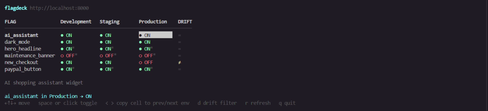
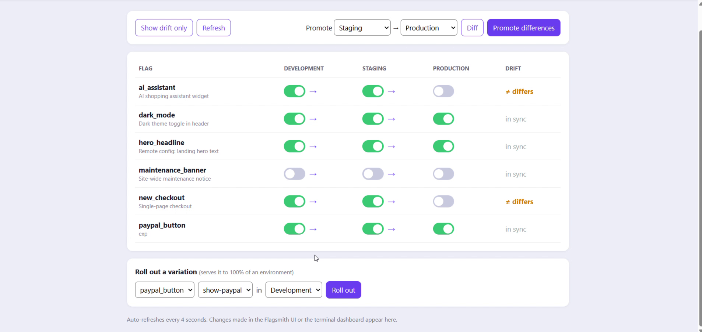
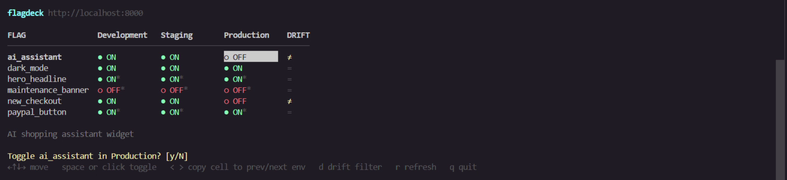
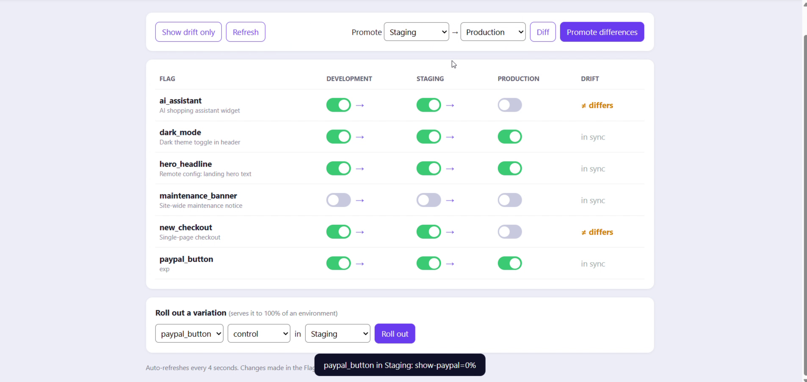
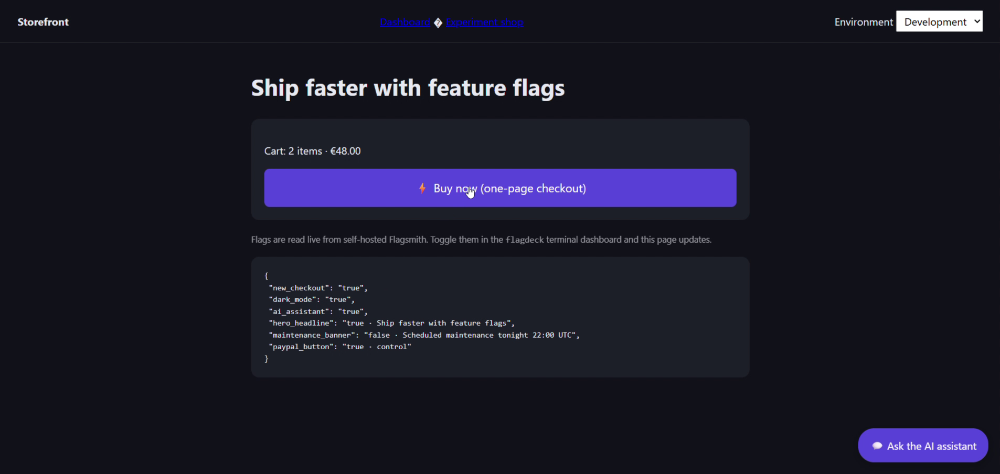
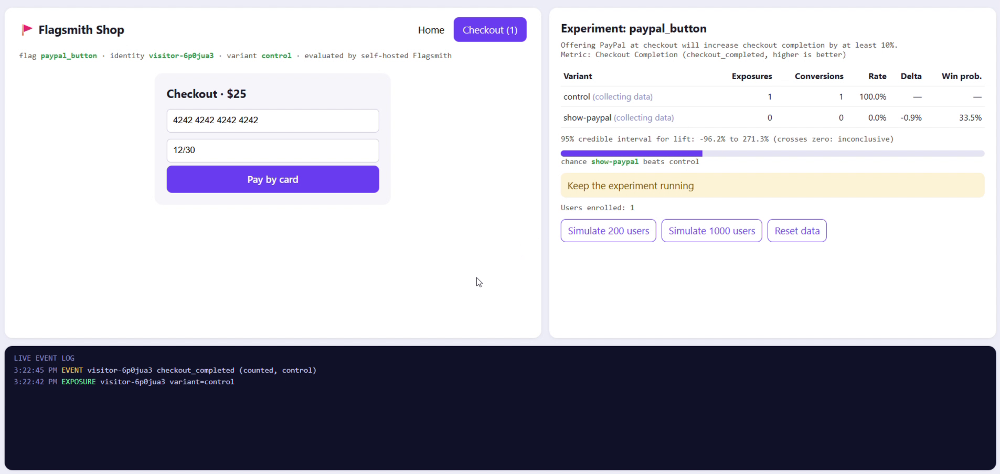
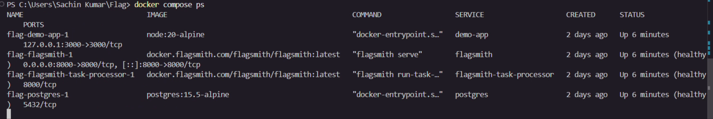
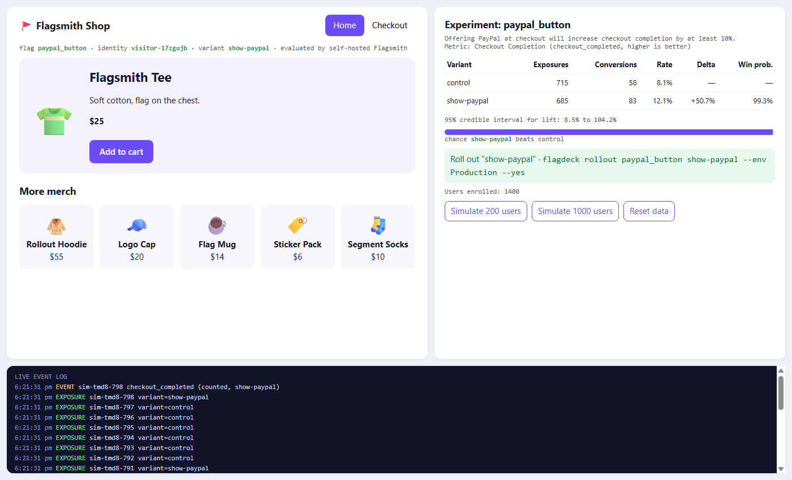

# flagdeck

A terminal dashboard and CLI for **self-hosted [Flagsmith](https://github.com/Flagsmith/flagsmith)**, plus a one-command Docker setup with seeded data and a live demo app.

Built for the Toggle Wars hackathon, Track 03: Build on Open Source Flagsmith.

## The problem

Flagsmith's dashboard shows one environment at a time. Before a release you want to answer "what is different between Staging and Production?" and fix it without clicking through every flag in every environment. Getting a local Flagsmith with realistic data to try this against also takes manual setup.

## Screenshots

| Terminal dashboard | Web dashboard |
| --- | --- |
|  |  |
| **Production asks first** | **Rolling out a variation** |
|  |  |
| **Storefront driven by flags** | **Sample shop with a multivariate flag** |
|  |  |

One command brings it all up:



## What it does

| Piece | What you get |
| --- | --- |
| `docker compose up` | Self-hosted Flagsmith (Postgres, API, task processor), a seed job that creates the admin, org, project, 3 environments and 5 flags, and a demo storefront at <http://localhost:3000> |
| `flagdeck` (TUI) | A flags × environments matrix. Move with arrows, toggle with space, copy a cell to the neighbouring environment with `<` / `>`, filter to drifted flags with `d`. It refreshes every 4 seconds, so changes made in the Flagsmith UI show up. |
| Web dashboard (`/dashboard`) | The same matrix in the browser. Every control works: toggle switches, `→` copy-to-next-environment buttons, drift filter, refresh, environment diff, promote differences, and a variation rollout form. Production changes ask for confirmation. |
| `flagdeck diff/promote` | Show or apply the difference between two environments. Promoting to a production-like environment is a dry run unless you pass `--yes`. The TUI asks for `y/N` before touching Production. |
| `flagdeck ls --json` | Machine-readable matrix for CI checks (`flagdeck diff staging production` exits 1 when they differ). |
| Demo storefront | Reads flags through the Flagsmith SDK API. Toggle `dark_mode`, `new_checkout`, `ai_assistant`, `maintenance_banner` or edit `hero_headline` in the TUI and the page changes within 1.5 seconds. |

It uses the Management API (login token or organisation API key) and the public Flags API. No runtime dependencies, Node 18.3 or newer.

## Quick start

```bash
git clone https://github.com/iittjjee2024/flagdeck.git && cd flagdeck
docker compose up -d          # first run takes about 2 minutes while Flagsmith migrates
node bin/flagdeck.js          # open the dashboard
```

- Flagsmith UI: <http://localhost:8000> (`admin@example.com` / `flagdeck-demo-1`)
- Web dashboard: <http://localhost:3000/dashboard>
- Demo storefront: <http://localhost:3000>
- Sample shop with a PayPal-button test: <http://localhost:3000/shop>

The demo app can change flags through the Management API, so Docker publishes it on `127.0.0.1` only. Do not expose port 3000 to a network.

Install the command globally with `npm link`, then run `flagdeck`.

### Use it with your own Flagsmith

```bash
export FLAGSMITH_URL=https://flags.example.com
export FLAGSMITH_ORG_TOKEN=...        # organisation API key (or FLAGDECK_TOKEN for a user token)
flagdeck --project 12
```

## Sample app: PayPal-button rollout on self-hosted Flagsmith

A starter template for building a flag-driven app on your own Flagsmith, modelled on [Flagsmith's PayPal button example](https://docs.flagsmith.com/experimentation/example-paypal-button). Open the shop at `/shop` on the demo app (port 3000). Copy `src/shop.js` as a starting point for your own multivariate-flag app.



| Step in the docs | What flagdeck does |
| --- | --- |
| Create a multivariate flag `paypal_button` | `flagdeck seed` creates it: `control` plus a `show-paypal` option at 50%. |
| Create the metric | `checkout_completed`, occurrence, higher is better. |
| Hypothesis | "Offering PayPal at checkout will increase checkout completion by at least 10%." |
| Serve variations | The shop asks Flagsmith for the flag per identity (`/api/v1/identities/`). Flagsmith's multivariate bucketing decides who sees PayPal. |
| Record exposures | When the checkout page is shown, the shop records an exposure. It is counted once per identity, first variant wins, and identities served two variants are excluded. |
| Track conversions | `checkout_completed` counts only after the identity's first exposure. |
| Read results | Exposures, rate, delta, 95% credible interval, win probability, sample ratio mismatch warning and "collecting data" thresholds, using a Beta-Binomial Bayesian model (`src/stats.js`). |
| Roll out the winner | `flagdeck rollout paypal_button show-paypal --env Production --yes` sets the allocation to 100%. |

Click **Simulate 1000 users** (or run `flagdeck experiment simulate --users 1000`) to generate traffic with a real difference between variants (8% control, 11.5% PayPal). Open the checkout yourself to see the PayPal button appear for the show-paypal bucket and the event log update.

**What is and is not Flagsmith here.** Variation assignment, the flag and the rollout all run on your self-hosted Flagsmith. Flagsmith's built-in Experiments results page needs a connected warehouse, so flagdeck records exposures and conversions itself and computes the statistics locally. It does not send events to Flagsmith's event ingestion.

## Commands

```
flagdeck                           interactive matrix
flagdeck ls [--drift] [--json]
flagdeck toggle <flag> <env> [on|off] [--yes]
flagdeck diff <from> <to>
flagdeck promote <from> <to> [flag…] [--dry-run] [--yes]
flagdeck seed                      idempotent demo data
flagdeck demo [--port 3000]
flagdeck rollout <flag> <variant> [--env Production] [--yes]
flagdeck experiment [results|simulate|reset] [--users N]
```

Environment names match by prefix and ignore case (`prod` means `Production`).

## Demo video

The recording script is in [docs/DEMO_SCRIPT.md](docs/DEMO_SCRIPT.md).

## How Flagsmith is used

- Management API: organisations, projects, environments, features, per-environment feature states (read, PATCH).
- Flags API with environment keys: the demo app evaluates flags exactly as an SDK would.
- Self-hosted via the official Docker image and Postgres.

## Tests

```bash
node --test test/flagdeck.test.js test/experiment.test.js
node test/smoke.mjs            # exercises every web dashboard action against a running stack
```

Unit tests cover drift detection, promote (including dry run), production confirmation and rendering. The integration path (seed, toggle, promote, demo) is exercised by `docker compose up`.

## License

BSD-3-Clause, matching Flagsmith.
